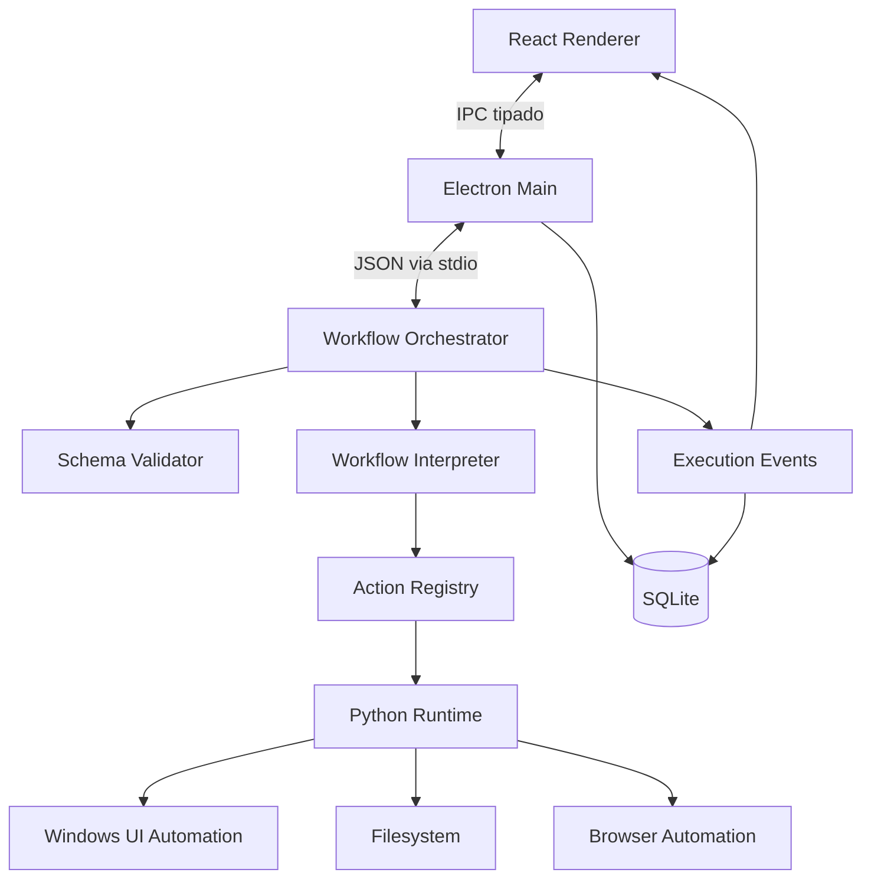

# Automation Studio — Arquitetura Técnica

**Versão:** 1.0  
**Arquitetura:** desktop local, modular, com motor de execução isolado

## 1. Visão arquitetural

O sistema será dividido em três processos/camadas principais:

1. **Electron Main:** ciclo de vida do aplicativo, janelas, IPC seguro, arquivos locais e integração com o sistema operacional.
2. **Renderer React:** interface, dashboard, editor visual, formulários de configuração e monitoramento.
3. **Automation Engine Python:** execução efetiva das ações de automação.

O Node/Electron coordena a aplicação. O Python executa as ações. O React Flow apenas representa e edita o grafo; ele não executa o fluxo.

## 2. Diagrama lógico



## 3. Stack tecnológica

| Camada | Tecnologia | Uso |
|---|---|---|
| Desktop | Electron | Janela, ciclo de vida e integração local |
| UI | React + TypeScript | Interface |
| Estilo | Tailwind CSS | Design system |
| Canvas | React Flow | Editor de nós |
| Estado UI | Zustand | Estado compartilhado |
| Validação | Zod | Validar payloads no TypeScript |
| Orquestração | Node.js + TypeScript | Interpretador e gestão de execução |
| Engine | Python | Ações desktop |
| Automação de mouse/teclado | PyAutoGUI ou alternativa validada | Entrada do usuário |
| Automação Windows | pywinauto / UI Automation | Janelas e controles acessíveis |
| Navegador | Playwright | Automação web |
| OCR | Tesseract ou solução equivalente | Leitura de texto em tela, fase posterior |
| Banco | SQLite | Persistência local |
| Testes UI | Playwright | Testes da interface |
| Testes Node | Vitest | Testes unitários |
| Testes Python | pytest | Testes do motor |
| Empacotamento | electron-builder | Instalador Windows |

As bibliotecas devem ser avaliadas por compatibilidade, licença, manutenção e limitações do Windows antes de fixar versões.

## 4. Estrutura de diretórios sugerida

```text
automation-studio/
├── apps/
│   └── desktop/
│       ├── src/
│       │   ├── main/
│       │   │   ├── ipc/
│       │   │   ├── services/
│       │   │   ├── windows/
│       │   │   └── database/
│       │   ├── preload/
│       │   └── renderer/
│       │       ├── app/
│       │       ├── components/
│       │       ├── features/
│       │       │   ├── dashboard/
│       │       │   ├── editor/
│       │       │   ├── automations/
│       │       │   ├── executions/
│       │       │   ├── schedules/
│       │       │   └── settings/
│       │       ├── hooks/
│       │       ├── stores/
│       │       └── styles/
│       └── package.json
├── packages/
│   ├── workflow-schema/
│   ├── workflow-validator/
│   ├── workflow-interpreter/
│   ├── node-registry/
│   ├── execution-manager/
│   └── shared-types/
├── engine/
│   └── python/
│       ├── automation_engine/
│       │   ├── runtime/
│       │   ├── protocol/
│       │   ├── actions/
│       │   │   ├── mouse/
│       │   │   ├── keyboard/
│       │   │   ├── windows/
│       │   │   ├── files/
│       │   │   ├── browser/
│       │   │   └── system/
│       │   ├── recorder/
│       │   └── utils/
│       └── tests/
├── database/
│   ├── migrations/
│   └── seeds/
├── templates/
├── docs/
├── scripts/
└── package.json
```

## 5. Modelo de fluxo

O fluxo deve ser armazenado em formato JSON versionado. O formato visual (posição, cor, tamanho) deve ser separado dos parâmetros de execução sempre que possível.

Exemplo conceitual:

```json
{
  "schemaVersion": 1,
  "id": "flow-id",
  "name": "Organizar PDFs",
  "nodes": [
    {
      "id": "start",
      "type": "trigger.manual",
      "version": 1,
      "position": {"x": 100, "y": 100},
      "config": {}
    },
    {
      "id": "list",
      "type": "files.list",
      "version": 1,
      "position": {"x": 350, "y": 100},
      "config": {
        "path": "{{variables.downloadsPath}}"
      }
    }
  ],
  "edges": [
    {
      "id": "edge-1",
      "source": "start",
      "sourceHandle": "next",
      "target": "list",
      "targetHandle": "input"
    }
  ],
  "variables": {
    "downloadsPath": {
      "type": "string",
      "value": "C:\\Users\\Public\\Downloads"
    }
  },
  "settings": {
    "timeoutSeconds": 600,
    "errorPolicy": "stop"
  }
}
```

Não usar `eval` ou execução direta de expressões JavaScript/Python fornecidas pelo fluxo. Expressões devem ser interpretadas por um mecanismo limitado e tipado.

## 6. Contrato de nó

Cada tipo de nó deve declarar:
- `type`: identificador estável, como `files.move`.
- `version`: versão do contrato.
- `label`: nome apresentado.
- `category`: categoria na biblioteca.
- `inputs`: portas de entrada.
- `outputs`: portas de saída.
- `configSchema`: parâmetros obrigatórios e opcionais.
- `executionHandler`: executor associado.
- `capabilities`: permissões ou recursos necessários.

Exemplo de metadados:

```json
{
  "type": "files.move",
  "version": 1,
  "label": "Mover arquivo",
  "category": "files",
  "inputs": [{"id": "input", "kind": "flow"}],
  "outputs": [
    {"id": "success", "kind": "flow"},
    {"id": "error", "kind": "flow"}
  ],
  "configSchema": {
    "source": "string",
    "destination": "string",
    "overwrite": "boolean"
  }
}
```

O esquema real deverá usar JSON Schema ou validação equivalente, não strings simplificadas como no exemplo.

## 7. Interpretador e execução

### 7.1 Pipeline

1. Receber o documento do fluxo.
2. Validar versão e estrutura.
3. Validar tipos de nós e parâmetros.
4. Verificar conexões e alcançabilidade.
5. Criar contexto isolado de execução.
6. Resolver variáveis e entradas.
7. Executar o nó inicial.
8. Seguir a saída indicada pelo resultado do nó.
9. Emitir eventos de estado e log.
10. Finalizar, cancelar ou tratar erro.

### 7.2 Contexto de execução

Cada execução deve possuir:
- `executionId`.
- `workflowId`.
- `workflowVersion`.
- `variables`.
- `inputs`.
- `currentNodeId`.
- `startedAt`.
- `cancellationToken`.
- `timeout`.
- `logger`.
- `artifacts`.

### 7.3 Resultado de ação

Contrato conceitual:

```json
{
  "status": "success",
  "outputs": {
    "fileCount": 12
  },
  "next": "success",
  "message": "Arquivos listados."
}
```

Falhas devem possuir código estável, mensagem segura para o usuário e detalhes técnicos separados.

### 7.4 Pausa e cancelamento

- O orquestrador deve manter estado de execução.
- Ações longas devem verificar cancelamento periodicamente.
- Pausa é cooperativa; nem toda chamada de sistema pode ser interrompida instantaneamente.
- A interface deve explicar quando uma ação está finalizando antes de parar.
- Timeout deve encerrar uma ação que exceda o limite configurado, quando tecnicamente possível.

## 8. Comunicação Node ↔ Python

Recomendação para o MVP: processo Python separado, iniciado pelo Electron Main, com protocolo JSON Lines sobre stdin/stdout.

Regras:
- Uma mensagem JSON por linha.
- stdout reservado exclusivamente ao protocolo.
- Logs de diagnóstico do Python enviados para stderr.
- Cada mensagem possui `requestId`, `type` e `payload`.
- Eventos assíncronos possuem `eventId` e `executionId`.
- Validar tamanho e formato das mensagens.
- Tratar encerramento inesperado e reiniciar o processo quando seguro.

Exemplo de comando:

```json
{
  "type": "execute_action",
  "requestId": "req-123",
  "payload": {
    "executionId": "exec-456",
    "nodeId": "open-notepad",
    "action": "windows.open_app",
    "config": {
      "application": "notepad.exe"
    }
  }
}
```

Exemplo de evento:

```json
{
  "type": "action_completed",
  "requestId": "req-123",
  "payload": {
    "executionId": "exec-456",
    "nodeId": "open-notepad",
    "status": "success"
  }
}
```

## 9. Banco de dados

Tabelas principais:

### automations
- id (PK)
- name
- description
- category
- icon
- status
- current_version
- created_at
- updated_at

### workflow_versions
- id (PK)
- automation_id (FK)
- version_number
- definition_json
- created_at
- change_note

### executions
- id (PK)
- automation_id (FK)
- workflow_version_id (FK)
- status
- started_at
- finished_at
- duration_ms
- error_code
- error_message

### execution_logs
- id (PK)
- execution_id (FK)
- timestamp
- level
- node_id
- message
- details_json

### schedules
- id (PK)
- automation_id (FK)
- schedule_type
- schedule_config_json
- enabled
- last_run_at
- next_run_at

### settings
- key (PK)
- value_json
- updated_at

Segredos devem ficar no Windows Credential Manager, referenciados por identificador no banco. Não armazenar senhas em `definition_json`, logs ou exportações.

## 10. Segurança do Electron

- Ativar `contextIsolation`.
- Desativar `nodeIntegration` no renderer.
- Usar preload com API pequena e tipada.
- Validar todos os argumentos recebidos por IPC.
- Não expor APIs genéricas de filesystem ou shell ao renderer.
- Restringir navegação e conteúdo remoto.
- Aplicar Content Security Policy.
- Não carregar código remoto executável.
- Armazenar dados em diretório de usuário apropriado.

## 11. Segurança do motor

- Não oferecer execução arbitrária de shell no MVP.
- Implementar lista explícita de ações permitidas.
- Validar caminhos e impedir operações fora dos limites configurados quando aplicável.
- Exigir confirmação para exclusão e sobrescrita.
- Tratar downloads e arquivos externos como conteúdo não confiável.
- Não registrar senhas nem dados sensíveis.
- Executar com privilégios mínimos.
- Documentar limitações com aplicativos executados como administrador.

## 12. Automação de interface Windows

Preferência de estratégia:
1. APIs acessíveis/UI Automation para localizar controles.
2. Identificação de janela e processo.
3. Playwright para navegador.
4. Reconhecimento por imagem/OCR quando necessário.
5. Coordenadas absolutas apenas como último recurso.

O sistema deve informar que automações de interface podem falhar com alterações de layout, DPI, resolução, foco, permissões ou janelas modais.

## 13. Estratégia de testes

- Unitários para schemas, validação, interpretador e ações.
- Integração para protocolo Node/Python.
- Testes de banco e migrações.
- Testes end-to-end do editor.
- Testes em máquina Windows limpa.
- Testes com DPI e resoluções diferentes.
- Testes de cancelamento, timeout e falha do motor.
- Testes de importação de arquivos JSON inválidos.

Ações destrutivas devem ser testadas em diretórios temporários e dados descartáveis.

## 14. Build e distribuição

- Empacotar o aplicativo Electron.
- Empacotar o runtime Python e suas dependências.
- Gerar instalador Windows x64.
- Assinar digitalmente o instalador quando houver certificado disponível.
- Manter migrações de banco compatíveis.
- Criar processo de atualização com confirmação do usuário.
- Não exigir instalação global de Python para o usuário final.

## 15. Decisões que devem permanecer abertas até prototipagem

- Biblioteca definitiva de automação Windows.
- Mecanismo de OCR.
- Estratégia final de agendamento.
- Necessidade de banco adicional além do SQLite.
- Formato final do pacote de templates.
- Estratégia de atualização automática.

Essas decisões devem ser tomadas com protótipos pequenos e testes em Windows real, não apenas por preferência teórica.
